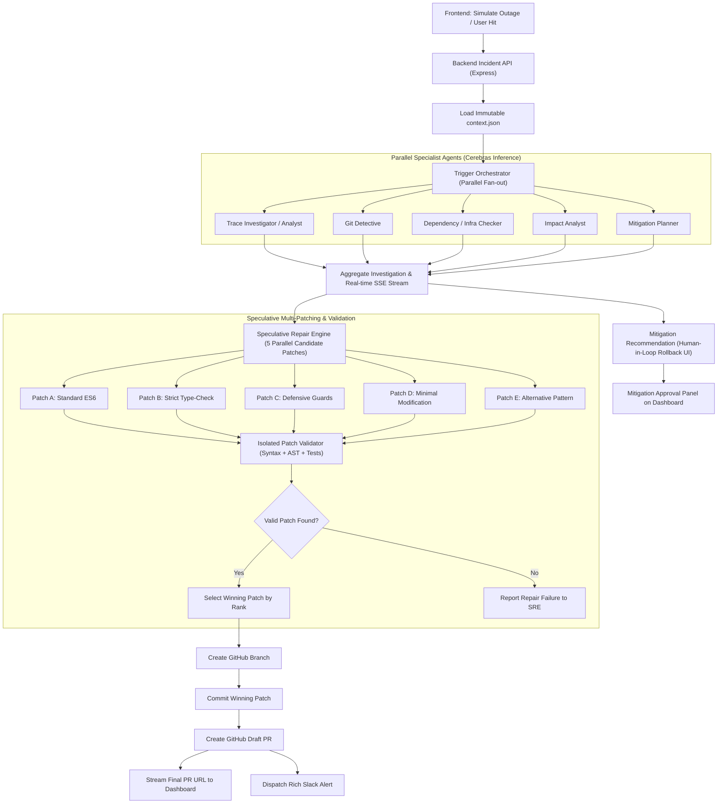
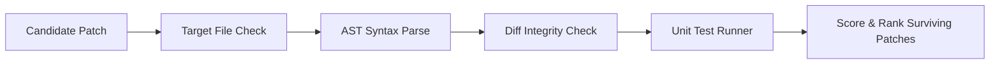

# Blinkfix / Swarm Zero: Master Implementation Roadmap

> **An Autonomous, Parallel-Agent Incident Triage & Speculative Self-Healing Engine**  
> *Target: Closed-loop detection, multi-agent triage, rollback recommendation, speculative patch generation, validation, and GitHub Draft PR creation.*

---

## 1. Executive Summary & Core Philosophy

**Blinkfix** (codenamed **Swarm Zero**) is an AI-powered autonomous incident response platform. Upon intercepting an application crash or unhandled error, Blinkfix initiates a closed-loop remediation pipeline:

$$\text{Detect} \longrightarrow \text{Investigate} \longrightarrow \text{Mitigate} \longrightarrow \text{Repair} \longrightarrow \text{Validate} \longrightarrow \text{Create PR}$$

Rather than building isolated modules or four chat windows that simply produce text, Blinkfix executes an **autonomous, end-to-end self-healing loop**:
1. **Ingests** the crash via custom webhook or simulated Sentry payload.
2. **Triages** the issue concurrently across specialized AI agents running on ultra-fast Cerebras inference.
3. **Formulates** an immediate mitigation recommendation (rollback / failover) with human-in-the-loop approval.
4. **Speculatively generates** 5 diverse candidate code patches in parallel.
5. **Validates** patches in an isolated environment (AST syntax, diff integrity, test execution).
6. **Opens a verified GitHub Draft Pull Request** and dispatches incident alerts to Slack and the live SRE Mission Control dashboard.

---

## 2. System Architecture & Information Flow



---

## 3. Technology Stack & Key Architectural Decisions

### 3.1 Recommended Concrete Tech Stack

| Component | Technology | Rationale & Selection Criteria |
| :--- | :--- | :--- |
| **Frontend UI** | **React + Vite + TypeScript** | Extremely fast HMR, lightweight bundle, instant rendering for high-frequency telemetry. |
| **UI Styling** | **Tailwind CSS + Lucide Icons** | Cyberpunk / terminal dark aesthetic (`#0a0d12`), monospace metrics, responsive multi-terminal grid. |
| **Backend API** | **Node.js + Express + TypeScript** | Event-driven non-blocking I/O ideal for concurrent asynchronous AI orchestration. |
| **AI Inference** | **Cerebras Cloud API** | Ultra-high throughput (1,000+ tokens/sec) providing sub-second multi-prompt burst completions. |
| **AI Coding Model** | **Codex / Llama 3.3 70B** | Code repair, stack trace localization, and diff generation. |
| **Real-Time Streaming**| **Server-Sent Events (SSE)** | Unidirectional HTTP streaming with zero WebSocket handshake overhead, automatic reconnect, and native browser `EventSource` support. |
| **GitHub Integration** | **Octokit (GitHub REST API)** | Programmatic branch creation, file commits, and Draft PR generation. |
| **Team Notifications**| **Slack Incoming Webhooks / Bot API** | Broadcasts rich Block Kit cards with root cause, affected service, MTTR, diff preview, and PR links. |
| **Deployment Context** | **Local `context.json`** | Pre-computed deployment intelligence (last 5 commits, dependencies, file tree) fitting into model context windows. |
| **Patch Validation** | **Babel/TypeScript AST + Temp Worktree** | Isolated verification ensuring patches parse, preserve valid diffs, and satisfy unit tests before PR creation. |

### 3.2 Key Engineering Improvements over Naive Implementations

| Area | Original Naive Approach | Swarm Zero Production-Grade Approach |
| :--- | :--- | :--- |
| **Orchestration** | Brittle `Promise.all()` (one failure crashes all) | Resilient `Promise.allSettled()` with graceful fallback degradation. |
| **Patch Selection** | Hardcoded or purely confidence-based winner | **Isolated multi-gate validation** (AST syntax, diff check, automated unit tests, and minimal change ranking). |
| **Deployment Context**| Static mutable shared global state | **Immutable incident context snapshot** generated at incident creation time. |
| **GitHub Action** | Simulated / mocked PR link | **Live Octokit integration** creating actual branches, commits, and Draft PRs. |
| **Incident Timer** | Artificially stopped timer at 2.0s | **Live high-precision millisecond stopwatch** measuring real-world end-to-end completion. |
| **Agent Visibility** | Raw text responses only | **Structured JSON contracts + real-time SSE streaming logs** for each terminal tile. |
| **Rollback Action** | Automatic unverified production changes | **Actionable recommendation panel with Human-in-the-Loop approval gate**. |

---

## 4. Concrete Directory Structure

```
Blinkfix/
├── apps/
│   ├── backend/
│   │   ├── src/
│   │   │   ├── config/
│   │   │   │   └── env.ts                     # Environment variables & Cerebras/GitHub/Slack keys
│   │   │   ├── routes/
│   │   │   │   ├── incident.routes.ts         # /api/incidents/simulate, /api/webhook/crash
│   │   │   │   └── github.routes.ts           # /api/github/pr-status
│   │   │   ├── controllers/
│   │   │   │   └── incident.controller.ts     # Request validation, incident lifecycle coordinator
│   │   │   ├── services/
│   │   │   │   ├── cerebras.service.ts        # Cerebras API client with latency metrics & pooling
│   │   │   │   ├── orchestrator.service.ts    # Parallel agent fan-out/fan-in runner
│   │   │   │   ├── github.service.ts          # Octokit branch, commit, and draft PR automation
│   │   │   │   ├── slack.service.ts           # Slack Block Kit notification dispatcher
│   │   │   │   └── context.service.ts         # Loads & snapshots deployment context.json
│   │   │   ├── agents/
│   │   │   │   ├── base-agent.ts              # Abstract runner with prompt parsing & telemetry
│   │   │   │   ├── trace-investigator.ts      # Stack trace parsing & line localization
│   │   │   │   ├── git-detective.ts           # Commit history diffing & blame attribution
│   │   │   │   ├── dependency-inspector.ts    # Package versions & upstream API health
│   │   │   │   ├── impact-analyst.ts          # Blast radius & regression risk scoring
│   │   │   │   └── mitigation-planner.ts      # Immediate rollback strategy & human gate
│   │   │   ├── repair/
│   │   │   │   ├── patch-generator.ts         # Dispatches 5 concurrent repair prompts
│   │   │   │   ├── patch-validator.ts         # AST syntax, git diff validity, unit test check
│   │   │   │   └── patch-selector.ts          # Heuristic scoring and winner ranking
│   │   │   ├── streaming/
│   │   │   │   └── event-stream.ts            # Server-Sent Events (SSE) broadcaster
│   │   │   ├── types/
│   │   │   │   ├── incident.types.ts          # Incident, CrashPayload, AgentEvent schemas
│   │   │   │   ├── patch.types.ts             # Candidate patch & validation schemas
│   │   │   │   └── context.types.ts           # Deployment context schema
│   │   │   └── server.ts                      # Express app initialization & port binding
│   │   ├── data/
│   │   │   └── context.json                   # Pre-computed deployment intelligence
│   │   ├── .env
│   │   └── package.json
│   │
│   └── frontend/
│       ├── src/
│       │   ├── components/
│       │   │   ├── Dashboard/                 # Main cockpit layout
│       │   │   ├── AgentTerminal/             # 5 parallel streaming terminal cards
│       │   │   ├── IncidentPanel/             # Incident metadata, error payload viewer
│       │   │   ├── MitigationPanel/           # Rollback recommendation & approval action
│       │   │   ├── PatchComparison/           # 5 candidate patches viewer with tabs
│       │   │   ├── ResolutionPanel/           # Winning patch, unified diff, PR link
│       │   │   └── Timer/                     # Live T-Zero millisecond stopwatch
│       │   ├── hooks/
│       │   │   ├── useIncidentStream.ts       # SSE event consumer hook
│       │   │   └── useStopwatch.ts            # High-resolution 60 FPS timer hook
│       │   ├── services/
│       │   │   └── incident.api.ts            # Axios/Fetch client for triggering incidents
│       │   ├── types/
│       │   │   └── dashboard.types.ts         # State definitions for UI components
│       │   ├── App.tsx
│       │   └── main.tsx
│       ├── tailwind.config.js
│       └── package.json
│
├── fixtures/
│   ├── mock-repo/
│   │   ├── src/
│   │   │   ├── payments.js                    # Buggy target file (e.g. TypeError in currency conversion)
│   │   │   └── auth.js                        # Secondary target file
│   │   └── package.json
│   └── sentry-crashes/
│       ├── payment-typeerror.json
│       ├── stripe-gateway-timeout.json
│       └── auth-null-pointer.json
│
└── docs/
    ├── Swarm Zero System Architecture.md
    ├── Blinkfix Implementation Roadmap.md
    └── Architecture.jpeg
```

---

## 5. Development Strategy: The Vertical Slice First

> [!IMPORTANT]
> **Avoid building isolated modules in silos.**  
> Before expanding to the full 5-agent swarm and 5-patch generator, build a **complete vertical slice (Milestone 1)** first:
>
> `Simulate Outage` $\longrightarrow$ `1 Agent Investigation` $\longrightarrow$ `1 Patch Generation` $\longrightarrow$ `Syntax Validation` $\longrightarrow$ `Real GitHub Draft PR` $\longrightarrow$ `Frontend Display`
>
> Once this single-thread loop functions seamlessly end-to-end, expand horizontally (Milestone 2) into the full parallel swarm, 5 candidate repair strategies, and Slack integration.

---

## 6. Ten-Phase Detailed Implementation Plan

```
┌────────────────────────────────────────────────────────────────────────────────────────┐
│                        8-HOUR HACKATHON TIMELINE & ROADMAP                             │
├──────────────┬──────────────┬──────────────┬──────────────┬──────────────┬─────────────┤
│ 00:00 - 01:00│ 01:00 - 02:30│ 02:30 - 04:00│ 04:00 - 05:30│ 05:30 - 07:00│07:00 - 08:00│
│  Phase 1 & 2 │  Phase 3 & 4 │  Phase 5 & 6 │  Phase 7 & 8 │   Phase 9    │  Phase 10   │
│ Setup & Data │ Agent Swarm  │ SSE & Spec.  │ GitHub, Slack│ Dashboard UI │ Latency &   │
│ Context.json │ & Triggers   │ Multi-Patch  │ & Mitigation │ & Terminals  │ Rehearsal   │
└──────────────┴──────────────┴──────────────┴──────────────┴──────────────┴─────────────┘
```

---

### Phase 1 — Project Initialization & Scaffolding
* **Priority:** 1 | **Estimated Duration:** 25–30 min
* **Objective:** Establish backend and frontend projects, configure TypeScript, set up environment secrets, and verify independent execution.

#### Action Items:
1. Initialize `backend` with `express`, `cors`, `dotenv`, `zod`, `@octokit/rest`, and `tsx`.
2. Initialize `frontend` with `vite`, `@vitejs/plugin-react`, `tailwindcss`, and `lucide-react`.
3. Configure `.env` with required API keys:
   - `CEREBRAS_API_KEY`: Ultra-fast inference access.
   - `GITHUB_TOKEN`: Fine-grained personal access token with repo/PR permissions.
   - `GITHUB_OWNER` & `GITHUB_REPO`: Target repository for automated PRs.
   - `SLACK_WEBHOOK_URL`: (Optional/recommended) for incident broadcasts.
4. Verify both applications boot cleanly (`npm run dev`).

**Phase 1 Deliverable:** Backend responds on `http://localhost:3001/api/health` and Frontend renders on `http://localhost:5173`.

---

### Phase 2 — Pre-Computed Deployment Intelligence (`context.json`)
* **Priority:** 2 | **Estimated Duration:** 30 min
* **Objective:** Create the pre-computed repository state that fits comfortably into model prompt context windows without requiring a complex vector database.

#### Concrete Schema:
```json
{
  "repository": "swarm-zero-demo",
  "branch": "main",
  "deployment": {
    "version": "1.0.4",
    "lastDeployment": "2026-10-31T10:00:00Z",
    "deployedBy": "ci-runner-42"
  },
  "recentCommits": [
    {
      "hash": "abc104",
      "author": "alex@company.com",
      "timestamp": "2026-10-31T09:45:00Z",
      "message": "Refactor payment processing currency conversion",
      "changedFiles": ["src/payments.js"]
    },
    {
      "hash": "def456",
      "author": "sam@company.com",
      "timestamp": "2026-10-30T16:20:00Z",
      "message": "Update Stripe SDK version to 12.4.0",
      "changedFiles": ["package.json"]
    }
  ],
  "dependencies": {
    "express": "4.18.2",
    "stripe": "12.4.0",
    "axios": "1.6.0"
  },
  "files": {
    "src/payments.js": "const stripe = require('stripe')(process.env.STRIPE_KEY);\n\nasync function processPayment(cart) {\n  // Bug: user currency metadata is undefined when cart.currency is missing\n  const amountInCents = cart.total * cart.currency.exchangeRate;\n  return await stripe.charges.create({ amount: amountInCents });\n}\nmodule.exports = { processPayment };",
    "src/auth.js": "function verifyToken(req, res, next) { next(); }\nmodule.exports = { verifyToken };"
  }
}
```

#### Action Items:
1. Create `backend/data/context.json` containing the payload above.
2. Build `context.service.ts` to read and provide an **immutable deep copy** for each incident request.
3. Validate total token count (<1,500 tokens) to ensure rapid model inference.

**Phase 2 Deliverable:** `context.service.ts` reliably supplies deployment context to all downstream agents.

---

### Phase 3 — Autonomous AI Agent System
* **Priority:** 3 | **Estimated Duration:** 60 min
* **Objective:** Construct the 5 specialized triage agents using Cerebras API with structured outputs and parallel execution.

#### Agent Roles & Responsibilities:

| Agent | Responsibility | Key Output Fields |
| :--- | :--- | :--- |
| **1. Trace Investigator** | Analyzes stack trace & extracts broken function/line. | `brokenFile`, `functionName`, `lineNumber`, `technicalCause` |
| **2. Git Detective** | Compares error with recent commits & deployment time. | `culpritCommitHash`, `author`, `confidence`, `reasoning` |
| **3. Dependency Inspector**| Verifies third-party APIs vs internal code bugs. | `isExternalOutage`, `serviceName`, `dependencyStatus` |
| **4. Impact Analyst** | Evaluates blast radius, affected routes, and severity. | `severity` (P0/P1/P2), `affectedFeatures`, `blastRadiusScore` |
| **5. Mitigation Planner** | Proposes immediate rollback or failover action. | `recommendedAction`, `targetCommit`, `riskLevel`, `requiresHumanApproval` |

#### Agent Execution Function:
```typescript
async function runAgent<T>(
  agentName: string,
  systemPrompt: string,
  incident: IncidentPayload,
  context: DeploymentContext
): Promise<AgentResult<T>> {
  const startTime = Date.now();
  // 1. Dispatch prompt to Cerebras API with JSON mode
  // 2. Stream thought updates to SSE event bus
  // 3. Parse and validate structured output with Zod
  const durationMs = Date.now() - startTime;
  return { agentName, durationMs, data: parsedOutput };
}
```

#### Parallel Execution Runner:
```typescript
const [traceResult, gitResult, depResult, impactResult, mitigationResult] = 
  await Promise.allSettled([
    runTraceInvestigator(incident, context),
    runGitDetective(incident, context),
    runDependencyInspector(incident, context),
    runImpactAnalyst(incident, context),
    runMitigationPlanner(incident, context),
  ]);
```

**Phase 3 Deliverable:** All agents execute in parallel via `Promise.allSettled()`, returning typed diagnostics within 300–600ms.

---

### Phase 4 — Incident Trigger & Simulation API
* **Priority:** 4 | **Estimated Duration:** 30 min
* **Objective:** Build the webhook and simulation endpoints to accept raw Sentry/custom crash JSON and kick off the orchestration lifecycle.

#### Endpoint: `POST /api/incidents/simulate`
* **Sample Payload:**
  ```json
  {
    "eventId": "inc_20261031_001",
    "level": "error",
    "service": "checkout-service",
    "message": "TypeError: Cannot read properties of undefined (reading 'exchangeRate')",
    "exception": {
      "type": "TypeError",
      "value": "Cannot read properties of undefined (reading 'exchangeRate')"
    },
    "file": "src/payments.js",
    "line": 5,
    "timestamp": "2026-10-31T10:05:00Z"
  }
  ```

#### Controller Logic:
1. Generate unique `incidentId`.
2. Snapshot current `context.json`.
3. Kick off async orchestration in the background.
4. Immediately respond with `{ incidentId, status: "triage_initiated", timestamp }`.

**Phase 4 Deliverable:** Hitting `POST /api/incidents/simulate` returns immediately with an `incidentId` and starts background processing.

---

### Phase 5 — Real-Time Agent Streaming (Server-Sent Events)
* **Priority:** 5 | **Estimated Duration:** 45 min
* **Objective:** Establish the unidirectional SSE stream between backend and frontend for real-time terminal rendering.

#### Endpoint: `GET /api/incidents/:incidentId/stream`

#### Complete SSE Event Types Specification:

| Event Type | Emitter Trigger | Payload Summary |
| :--- | :--- | :--- |
| `incident_started` | Ingestion accepted | `incidentId`, `timestamp`, `errorSummary` |
| `agent_started` | Agent spawned | `agentName`, `timestamp` |
| `agent_update` | Streaming agent tokens / progress | `agentName`, `chunkText`, `currentPhase` |
| `agent_completed` | Agent finishes | `agentName`, `durationMs`, `structuredResult` |
| `mitigation_ready`| Mitigation planner resolves | `recommendedAction`, `targetCommit`, `riskLevel` |
| `repair_started` | Patch generator dispatches | `candidateCount: 5`, `targetFile` |
| `patch_completed` | Single patch generated | `patchId`, `approach`, `confidence` |
| `patch_verified` | Validation suite finishes | `winningPatchId`, `testsPassed`, `diff` |
| `pr_created` | GitHub Draft PR opened | `prUrl`, `prNumber`, `branchName` |
| `slack_sent` | Slack alert dispatched | `channel`, `messageTimestamp` |
| `incident_completed`| Full pipeline resolved | `totalDurationMs`, `mttr` |
| `incident_failed` | Unrecoverable error | `reason`, `failedStage` |

#### Client Hook (`useIncidentStream.ts`):
- Connects via native `const es = new EventSource('/api/incidents/' + id + '/stream')`.
- Updates React state per event type, powering the live terminals and status pills.

**Phase 5 Deliverable:** Frontend receives live streamed updates across each stage of incident triage and remediation.

---

### Phase 6 — Speculative Multi-Patching & Candidate Validation
* **Priority:** 6 | **Estimated Duration:** 60 min
* **Objective:** Concurrently generate 5 diverse repair candidates, execute multi-gate validation, and select the winning patch based on objective criteria.

#### The 5 Candidate Patch Strategies:

| Patch ID | Strategy | Description |
| :--- | :--- | :--- |
| **Patch A** | **Standard ES6 Fix** | Idiomatic modern JavaScript fix (e.g. optional chaining `cart?.currency?.exchangeRate ?? 1.0`). |
| **Patch B** | **Strict Type-Checking** | Explicit runtime validation ensuring `typeof cart.currency === 'object'`. |
| **Patch C** | **Defensive Programming**| Default fallback object assignment (`const currency = cart.currency \|\| DEFAULT_CURRENCY`). |
| **Patch D** | **Minimal Modification**| Smallest character diff to prevent exception throwing. |
| **Patch E** | **Alternative Pattern** | Guard clause early return with explicit error logging. |

#### Isolated Validation Engine (`patch-validator.ts`):


1. **Target File Gate:** Verify the patch only modifies the broken file (`src/payments.js`).
2. **AST Syntax Parse:** Parse the patched code with `@babel/parser` / TypeScript compiler API; reject syntax errors immediately.
3. **Diff Integrity Check:** Ensure patch produces a clean unified diff against base code.
4. **Unit Test Runner:** Execute isolated test assertion against the patched code.
5. **Heuristic Ranking:** Rank surviving valid patches:
   $$\text{Score} = (\text{Tests Passed} \times 50) + (\text{Model Confidence} \times 30) - (\text{Diff Line Count} \times 2)$$

**Phase 6 Deliverable:** 5 concurrent patches generated in parallel; exactly one objectively verified patch is crowned the winner.

---

### Phase 7 — GitHub & Slack External Integrations
* **Priority:** 7 | **Estimated Duration:** 60 min
* **Objective:** Automate production engineering actions: open an authentic Draft PR on GitHub and post an incident notification to Slack.

#### 7.1 GitHub Workflow (`github.service.ts`):
1. **Branch Creation:** `octokit.git.createRef` creating `swarm-zero/fix/incident-[ID]`.
2. **Commit Patch:** Update the target file with the winning patch content.
3. **Draft Pull Request:**
   - **Branch:** `swarm-zero/fix/incident-[ID]` $\rightarrow$ `main`.
   - **Title:** `[Swarm Zero] Automated fix for payment TypeError (Incident #001)`
   - **Description Body:**
     - 🚨 **Incident Details:** Timestamp, service, failing error message.
     - 🔍 **Root Cause:** Blamed commit (`abc104`), author, and file line.
     - 🧪 **Validation Results:** Syntax verified, AST clean, unit tests passed.
     - 🛡️ **Mitigation Recommendation:** Immediate rollback recommendation.
     - 📝 **Code Diff:** Unified diff preview.

#### 7.2 Slack Notification (`slack.service.ts`):
- Formats an interactive Slack Block Kit message:
  - 🚨 **Header:** `P0 Incident Auto-Mitigated by Blinkfix`
  - 📊 **Fields:** `Service: checkout` | `MTTR: 1.84s` | `Root Cause: payments.js:5`
  - 🔘 **Action Buttons:** `[View GitHub Draft PR]` | `[Approve Immediate Rollback]` | `[Open SRE Dashboard]`

**Phase 7 Deliverable:** A real Draft PR appears in the GitHub repository and an alert is posted to Slack.

---

### Phase 8 — Immediate Mitigation & Human Approval UI
* **Priority:** 8 | **Estimated Duration:** 30 min
* **Objective:** Implement a dedicated mitigation panel that advises the engineer on safe rollback actions and simulates human authorization.

#### UI Component (`MitigationPanel.tsx`):
- **Alert Banner:** ⚠️ *High Severity Outage Detected*
- **Recommendation:** *Rollback suspected regression introduced by commit `abc104` (PR #104).*
- **Risk Assessment:** *Low risk. Reverts 1 file (`payments.js`), restores stable currency fallback.*
- **Interactive Action Buttons:**
  - `[Approve Immediate Rollback]` $\rightarrow$ Triggers simulated rollback event and updates dashboard.
  - `[Reject / Rely on Patch]` $\rightarrow$ Dismisses rollback and prioritizes GitHub PR merge.

**Phase 8 Deliverable:** Interactive UI component allowing users to review and approve/reject mitigation actions.

---

### Phase 9 — Frontend Mission Control Dashboard
* **Priority:** 9 | **Estimated Duration:** 60–90 min
* **Objective:** Assemble the visual SRE cockpit featuring the T-Zero stopwatch, 5 parallel streaming terminals, patch comparison, and resolution panel.

#### Dashboard Layout Structure:
```
┌──────────────────────────────────────────────────────────────────────────────────┐
│  BLINKFIX // SWARM ZERO SRE COCKPIT               [LIVE]   MTTR: 1.84s           │
├─────────────────────────────────────┬────────────────────────────────────────────┤
│  INCIDENT CONTROL                   │  T-ZERO STOPWATCH                          │
│  [ SIMULATE OUTAGE ]                │  [ 00:01.842 ] (High Precision ms)        │
│  Service: checkout-service          │  Status: RECOVERY VERIFIED                 │
├─────────────────────────────────────┴────────────────────────────────────────────┤
│  PARALLEL AGENT SWARM TERMINALS (SSE STREAMING)                                  │
│  ┌──────────────────┐ ┌──────────────────┐ ┌──────────────────┐ ┌──────────────┐ │
│  │ Trace Analyst    │ │ Git Detective    │ │ Infra Checker    │ │ Impact / Mit │ │
│  │ payments.js:5    │ │ Commit: abc104   │ │ Stripe: Healthy  │ │ Blast: P0    │ │
│  │ [380ms]          │ │ [410ms]          │ │ [290ms]          │ │ [450ms]      │ │
│  └──────────────────┘ └──────────────────┘ └──────────────────┘ └──────────────┘ │
├──────────────────────────────────────────────────────────────────────────────────┤
│  RESOLUTION & SPECULATIVE REPAIR                                                 │
│  - Winning Patch: Patch A (Standard ES6 Optional Chaining)                       │
│  - GitHub PR: https://github.com/org/repo/pull/105 [VIEW PR]                     │
│  - Rollback Action: [APPROVE ROLLBACK OF PR #104]                               │
└──────────────────────────────────────────────────────────────────────────────────┘
```

#### Key Components:
1. **`Timer.tsx`:** Smooth 60 FPS millisecond counter running on `requestAnimationFrame`.
2. **`AgentTerminal.tsx`:** Monospace streaming text cards with color-coded status badges (`RUNNING`, `DONE`).
3. **`PatchComparison.tsx`:** Tabbed component displaying all 5 candidate fixes and highlighting the winning patch.
4. **`ResolutionPanel.tsx`:** Unified diff viewer and verified GitHub PR link button.

**Phase 9 Deliverable:** High-aesthetic, responsive, dark-mode dashboard providing full situational awareness.

---

### Phase 10 — Testing, Latency Optimization & Demo Hardening
* **Priority:** 10 | **Estimated Duration:** 45–60 min
* **Objective:** Rehearse end-to-end flow, optimize execution speed, and install bulletproof demo fail-safes.

#### Action Items:
1. **End-to-End Drill:** Run the entire flow from "Simulate Outage" click to PR creation.
2. **Latency Tuning:**
   - Keep agent prompts concise with pre-cached system instructions.
   - Use HTTP keep-alive connection pooling for Cerebras requests.
   - Fire GitHub and Slack calls asynchronously while UI completes streaming.
3. **Resilience & Demo Mode:**
   - Add a `DEMO_MODE=true` toggle in backend config.
   - If external APIs (GitHub rate limit or network glitch) fail, fallback gracefully to pre-computed fixtures without breaking the UI presentation.

**Phase 10 Deliverable:** A bulletproof, sub-2-second demo ready for live pitching.

---

## 7. Master 20-Task Implementation Checklist

Track progress across the 20 discrete milestones:

- [ ] **Task 01:** Initialize backend (Express, TypeScript, CORS, Dotenv).
- [ ] **Task 02:** Initialize frontend (React, Vite, Tailwind CSS, Lucide).
- [ ] **Task 03:** Configure Cerebras API client and benchmark latency.
- [ ] **Task 04:** Create deployment intelligence fixture (`context.json`).
- [ ] **Task 05:** Implement `POST /api/incidents/simulate` trigger endpoint.
- [ ] **Task 06:** Build Server-Sent Events (SSE) streaming broadcaster.
- [ ] **Task 07:** Build frontend `useIncidentStream` hook and connection state.
- [ ] **Task 08:** Implement Agent 1: Trace Investigator / Analyst.
- [ ] **Task 09:** Implement Agent 2: Git Detective.
- [ ] **Task 10:** Implement Agent 3: Dependency / Infra Inspector.
- [ ] **Task 11:** Implement Agent 4: Impact Analyst & Blast Radius Calculator.
- [ ] **Task 12:** Implement Agent 5: Mitigation Planner.
- [ ] **Task 13:** Implement parallel agent runner using `Promise.allSettled()`.
- [ ] **Task 14:** Implement 5-strategy speculative patch generator.
- [ ] **Task 15:** Build isolated AST syntax validator and patch selector.
- [ ] **Task 16:** Implement GitHub Octokit integration (branch, commit, Draft PR).
- [ ] **Task 17:** Implement Slack Block Kit incident alert dispatcher.
- [ ] **Task 18:** Build Frontend Mission Control (T-Zero Timer, Agent Terminals).
- [ ] **Task 19:** Build Mitigation Approval UI and Patch Comparison panel.
- [ ] **Task 20:** Run end-to-end integration test and demo hardening.

---

## 8. Definition of Done (DoD) for the Live Demo

1. **One-Click Execution:** Clicking "Simulate Outage" triggers the complete pipeline.
2. **Sub-2-Second Benchmark:** Parallel agents triage the incident and select a winning patch in under 2 seconds.
3. **Live Streaming UI:** Frontend terminals animate concurrently with zero freezing or UI lag.
4. **Objective Patch Selection:** The winning patch is selected via AST syntax and validation checks, not a hardcoded stub.
5. **Real GitHub PR:** A genuine Draft Pull Request is created in the demo repository with markdown summary and diff.
6. **Live Notification:** Slack alert is posted with actionable links and MTTR metrics.
