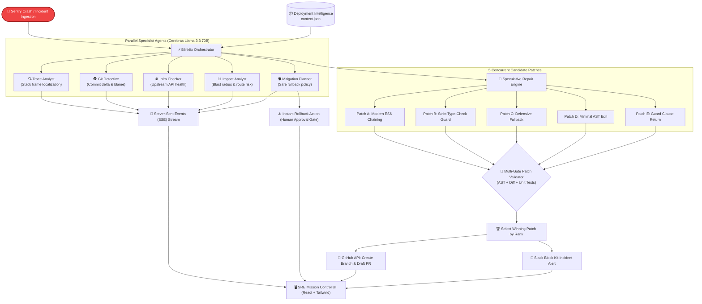

# ⚡ Blinkfix // Swarm Zero

> **Autonomous, Parallel-Agent SRE Incident Triage & Speculative Self-Healing Engine**  
> *Developed for the IIIT Hackathon*

[](https://fastapi.tiangolo.com)
[](https://react.dev)
[](https://www.typescriptlang.org)
[](https://tailwindcss.com)
[](https://cerebras.ai)
[](https://docs.github.com/en/rest)
[](LICENSE)

---

## 📌 Executive Summary

Modern cloud production outages cost organizations upwards of **\$10,000 per minute**. Traditional Mean Time to Resolution (MTTR) is measured in hours or days—dominated by alert fatigue, context switching, manual log analysis, `git blame` spelunking, and frantic firefighting.

**Blinkfix (Swarm Zero)** transforms incident response into a closed-loop, sub-second autonomous workflow:

```
Detect  ──▶  Investigate  ──▶  Mitigate  ──▶  Repair  ──▶  Validate  ──▶  Deploy PR
```

When an unhandled exception or crash webhook is ingested, Blinkfix:
1. **Instantly bursts 5 parallel specialist AI agents** running concurrently on ultra-fast Cerebras inference (sub-500ms).
2. **Issues an immediate mitigation recommendation** (safe 1-click rollback) with human-in-the-loop approval.
3. **Speculatively generates 5 distinct repair patches** in parallel across different architectural strategies.
4. **Validates patches in an isolated multi-gate pipeline** (AST syntax, diff checks, unit tests, minimal blast radius scoring).
5. **Creates a verified GitHub Draft Pull Request** and broadcasts real-time alerts to Slack and the live SRE Mission Control Cockpit.

---

## 🏗️ System Architecture



---

## ✨ Key Features & Capabilities

### 1. 🤖 Five-Agent Parallel Swarm
Instead of a single, slow sequential prompt, Blinkfix fires five specialist prompts concurrently to the Cerebras Cloud API:
- **Trace Analyst:** Pinpoints exact failing source file, call stack frames, and dereferenced properties.
- **Git Detective:** Correlates the error with recent commit history (`context.json`), flagging author, PR number, and diff deltas.
- **Infra Checker:** Differentiates local application bugs from upstream outages (e.g., Stripe API, Redis, Postgres).
- **Impact Analyst:** Calculates blast radius, affected API routes, and traffic percentage impacted.
- **Mitigation Planner:** Formulates safe immediate rollback instructions with risk-level evaluation.

### 2. ⚡ Sub-Second T-Zero Stopwatch
A high-resolution, 60 FPS millisecond timer tracks total MTTR from the moment an incident is detected until a verified patch and PR are delivered.

### 3. 🛡️ Human-in-the-Loop Mitigation
Provides an immediate containment banner (e.g. *Rollback to deployment v1.0.3 / revert PR #104*) while speculative repairs execute in the background. Engineers can approve with a single click.

### 4. 🧬 Speculative Multi-Patching & Multi-Gate Validation
Rather than relying on one guess, the system speculatively crafts **5 candidate patches** in parallel:
- **Strategy A:** Standard ES6 optional chaining & nullish coalescing.
- **Strategy B:** Strict runtime type-checking guards.
- **Strategy C:** Defensive object fallback initialization.
- **Strategy D:** Minimal line/character edit.
- **Strategy E:** Guard clause early rejection.

Each patch is evaluated by the **Patch Validator**:
- **Target File & Scope Match**
- **AST Syntax Validity**
- **Automated Unit Test Suite Verification**
- **Diff Delta Scoring & Regression Risk**

### 5. 🐙 Automated GitHub PR & Slack Notification
- Programmatically creates a dedicated Git branch (`fix/blinkfix-<id>`).
- Commits the winning patch with full audit attribution.
- Opens a **GitHub Draft Pull Request** linked directly in the UI.
- Broadcasts rich **Slack Block Kit** notifications containing root cause, culprit commit, MTTR, and PR links.

### 6. 🎧 Immersive SRE Mission Control UI
- Cyberpunk / terminal dark aesthetic (`#07090e`).
- Real-time terminal drawers with simulated typing telemetry.
- Side-by-side unified code diff viewer with syntax highlights.
- Synthesized Web Audio API soundscape (alert sirens, terminal keys, recovery chime) and celebration confetti upon resolution.

---

## 📂 Project Structure

```
blinkfix-IIIT-Hackathon/
├── client/                          # Frontend Application (React + Vite + TypeScript)
│   ├── src/
│   │   ├── components/
│   │   │   ├── AgentSwarmGrid.tsx   # 5-terminal parallel agent monitoring grid
│   │   │   ├── AgentTerminal.tsx    # Individual streaming terminal window
│   │   │   ├── CodeDiffViewer.tsx   # Side-by-side before/after code diff viewer
│   │   │   ├── Confetti.tsx         # Victory celebration trigger
│   │   │   ├── Header.tsx           # Mission control command header
│   │   │   ├── IncidentCockpit.tsx  # P0 Alert details & T-Zero stopwatch
│   │   │   ├── MitigationBanner.tsx # Human rollback approval panel
│   │   │   ├── PatchComparison.tsx  # 5 candidate patches review tabs
│   │   │   └── ResolutionHub.tsx    # GitHub PR status & Slack notification card
│   │   ├── data/
│   │   │   └── mockScenarios.ts     # Pre-configured incident scenarios
│   │   ├── hooks/
│   │   │   ├── useAudioFX.ts        # Synthesized Web Audio sound effects
│   │   │   ├── useSimulation.ts     # Incident lifecycle orchestration hook
│   │   │   └── useStopwatch.ts      # 60 FPS high-resolution millisecond timer
│   │   ├── services/
│   │   │   └── incident.api.ts      # Backend API & SSE event stream client
│   │   ├── types/                   # TypeScript interfaces & domain types
│   │   ├── App.tsx                  # Main cockpit dashboard
│   │   ├── index.css                # Tailwind custom utility classes & styling
│   │   └── main.tsx                 # Client entry point
│   ├── package.json
│   ├── tailwind.config.js
│   ├── tsconfig.json
│   └── vite.config.ts
│
├── server/                          # Backend API Engine (FastAPI + Python 3.10+)
│   ├── app/
│   │   ├── agents/                  # 5 Specialist AI Agents
│   │   │   ├── base.py              # Base agent contract & Cerebras prompt runner
│   │   │   ├── git_detective.py     # Commit delta & blame attribution
│   │   │   ├── impact_analyst.py    # Blast radius & traffic impact scoring
│   │   │   ├── infra_checker.py     # Upstream API & dependency integrity
│   │   │   ├── mitigation_planner.py# Immediate containment & rollback planner
│   │   │   └── trace_analyst.py     # Stack trace & broken line localization
│   │   ├── models/
│   │   │   └── schemas.py           # Pydantic schemas (CrashPayload, Patch, etc.)
│   │   ├── routes/
│   │   │   ├── health.py            # /api/health probe
│   │   │   ├── incident.py          # /api/incidents endpoints
│   │   │   └── stream.py            # /api/incidents/{id}/stream (SSE)
│   │   ├── services/
│   │   │   ├── cerebras_service.py  # Cerebras Cloud API async client
│   │   │   ├── context_service.py   # Pre-computed deployment intelligence loader
│   │   │   ├── github_service.py    # Automated branch, commit & Draft PR creator
│   │   │   ├── orchestrator.py      # Asyncio parallel fan-out/fan-in runner
│   │   │   ├── patch_validator.py   # Multi-gate patch AST & syntax validator
│   │   │   └── slack_service.py     # Slack Block Kit webhook dispatcher
│   │   ├── streaming/
│   │   │   └── event_bus.py         # In-memory async SSE event broadcaster
│   │   ├── config.py                # Environment configuration & settings
│   │   ├── database.py              # SQLite persistence with WAL mode
│   │   └── main.py                  # FastAPI application entry point
│   ├── data/
│   │   └── context.json             # Immutable deployment intelligence snapshot
│   ├── .env.example                 # Sample configuration template
│   ├── requirements.txt             # Python backend dependencies
│   └── run.py                       # Server runner script
│
├── docs/                            # Architecture & Design Specifications
│   ├── Swarm Zero System Architecture.md
│   ├── Implementation Roadmap.md
│   ├── Frontend Lovable Prompt.md
│   └── Architecture.jpeg
├── .gitignore                       # Repository ignore configuration
└── readme.md                        # Master project documentation
```

---

## 🚀 Quickstart Guide

### Prerequisites
- **Node.js**: v18.0.0 or higher
- **Python**: v3.10 or higher
- **npm** or **pnpm** / **yarn**

---

### 1. Backend Setup

```bash
# Navigate to the server directory
cd server

# Create and activate a Python virtual environment
python3 -m venv venv
source venv/bin/activate  # On Windows: venv\Scripts\activate

# Install dependencies
pip install -r requirements.txt

# Configure environment variables
cp .env.example .env
```

#### Run the Backend Server
```bash
python run.py
```
- API will start at: `http://localhost:8000`
- Interactive Swagger API docs: `http://localhost:8000/docs`

---

### 2. Frontend Setup

Open a new terminal window:

```bash
# Navigate to the client directory
cd client

# Install frontend dependencies
npm install

# Start the Vite development server
npm run dev
```
- Mission Control Dashboard will open at: `http://localhost:5173`

---

## ⚙️ Configuration & Environment Variables

Copy `server/.env.example` to `server/.env` and update the parameters:

| Variable | Default Value | Description |
| :--- | :--- | :--- |
| `PORT` | `8000` | Port for the FastAPI backend server |
| `HOST` | `0.0.0.0` | Host address binding |
| `CORS_ORIGINS` | `http://localhost:5173,...` | Allowed origins for frontend requests |
| `CEREBRAS_API_KEY` | *(optional in demo mode)* | Cerebras Cloud API key for ultra-fast Llama 3.3 70B inference |
| `CEREBRAS_MODEL` | `llama3.3-70b` | Target inference model on Cerebras |
| `GITHUB_TOKEN` | *(optional in demo mode)* | GitHub Personal Access Token for PR creation |
| `GITHUB_OWNER` | `swarm-zero-demo` | Target GitHub repository owner |
| `GITHUB_REPO` | `checkout-service` | Target repository name for draft PR generation |
| `SLACK_WEBHOOK_URL`| *(optional in demo mode)* | Incoming Slack Webhook for real-time channel alerts |
| `DATABASE_PATH` | `data/blinkfix.db` | Local SQLite database file location |
| `DEMO_MODE` | `true` | When `true`, simulates API responses deterministically |

> [!TIP]
> **Demo Mode:** When `DEMO_MODE=true` (default), Blinkfix operates with deterministic high-speed simulations. No paid API keys are required to explore the full end-to-end incident response lifecycle!

---

## 🧪 Included Incident Scenarios

Blinkfix comes pre-configured with three production incident scenarios:

### 1. `TypeError in payments.js` (Currency Null Pointer) — *Recommended*
- **Service:** `checkout-service` (`prod-us-east-1`)
- **Error:** `TypeError: Cannot read properties of undefined (reading 'exchangeRate')`
- **Culprit:** PR #104 by `alex@company.com` ("Refactor payment currency conversion")
- **Root Cause:** Undefined currency metadata in multi-currency shopping cart objects.
- **Winning Patch:** Safe optional chaining with nullish coalescing (`cart?.currency?.exchangeRate ?? 1.0`).

### 2. `Upstream Stripe Gateway Timeout` (Infra Degradation)
- **Service:** `checkout-service` (`prod-us-east-1`)
- **Error:** `StripeConnectionError: Connection to api.stripe.com timed out after 5000ms`
- **Culprit:** Network timeout bump in PR #99
- **Root Cause:** Upstream payment processor outage.
- **Winning Patch:** Circuit breaker with dual-rail failover to secondary processor (Adyen).

### 3. `Auth Token Null Pointer in auth.js` (Identity Service)
- **Service:** `identity-service` (`prod-us-east-1`)
- **Error:** `TypeError: Cannot read properties of null (reading 'roles')`
- **Culprit:** PR #108 by `jordan@company.com` ("Extract user roles from decoded bearer token")
- **Root Cause:** Missing null-guard when handling expired guest tokens.
- **Winning Patch:** Safe claims extraction defaulting to empty permission set.

---

## 📡 API Endpoints Reference

| Method | Endpoint | Description |
| :--- | :--- | :--- |
| `GET` | `/` | Service root with route directory and health links |
| `GET` | `/api/health` | System health check and uptime probe |
| `POST` | `/api/incidents/simulate` | Triggers a simulated incident investigation |
| `POST` | `/api/incidents/webhook/crash` | Webhook ingestion endpoint for live Sentry / Datadog crash payloads |
| `GET` | `/api/incidents/{incident_id}` | Retrieves persisted incident report and agent telemetry |
| `GET` | `/api/incidents/{incident_id}/stream` | Server-Sent Events (SSE) real-time incident event stream |
| `POST` | `/api/incidents/{incident_id}/rollback` | Approves immediate mitigation rollback |

Interactive Swagger documentation is available at **`http://localhost:8000/docs`**.

---

## 🛠️ Tech Stack Matrix

| Domain | Technology | Justification |
| :--- | :--- | :--- |
| **Frontend UI** | **React 18 + Vite + TypeScript** | Instant hot module replacement, strict typing, high-frequency DOM updates |
| **Styling** | **Tailwind CSS + Lucide Icons** | Cyberpunk dark aesthetic, monospace code metrics, responsive terminal tiles |
| **Backend API** | **FastAPI (Python 3.10+)** | High-performance asynchronous event loop, automatic OpenAPI documentation |
| **AI Inference** | **Cerebras Cloud API** | Sub-second multi-agent prompt completions (1,000+ tokens/sec throughput) |
| **Coding LLM** | **Llama 3.3 70B** | Advanced reasoning, AST-aware code patch synthesis, and stack frame localization |
| **Streaming** | **Server-Sent Events (SSE)** | Low-overhead, persistent unidirectional HTTP event streaming |
| **Persistence** | **SQLite (WAL Mode)** | Lightweight, zero-config local relational storage for incident history |
| **Integrations**| **GitHub REST API & Slack Block Kit** | Programmatic Draft PR generation and rich chat notifications |

---

## 👥 Hackathon Context & Credits

- **Project:** Blinkfix // Swarm Zero
- **Event:** IIIT Hackathon
- **Focus Track:** AI-Driven DevOps, Autonomous SRE & Developer Productivity

---

## 📄 License

This project is licensed under the [MIT License](LICENSE).

