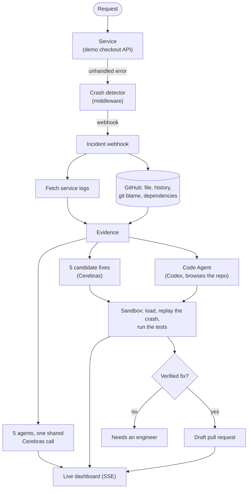

# Blinkfix // Swarm Zero

**When a service crashes, Blinkfix investigates it, writes several fixes, proves which ones really work by running them, and opens a draft pull request for the best one.**

Built for the IIIT Hackathon. Track: AI-driven DevOps and developer productivity.


---

## What it does

Most of the time spent on an outage goes to the work around the fix: reading logs, finding which change broke things, deciding whether the fault is in our code or someone else's, and then writing and checking a fix. Blinkfix does that work in seconds.

```
Crash  ->  Investigate  ->  Mitigate  ->  Repair  ->  Validate  ->  Deliver
```

1. **A service crashes.** A small middleware catches the unhandled error and sends a crash report to the incident webhook, with the stack trace and the request that failed (secrets masked).
2. **Blinkfix gathers evidence.** It fetches the service's recent logs, then reads the failing file, its commit history, `git blame` for the failing line and the dependency list from GitHub.
3. **Five agents investigate.** They answer five questions: where did it fail, which change caused it, is it our code or an outside service, how bad is it, and what is the safest immediate action. All five share one Cerebras call.
4. **Fixes are written.** Cerebras writes five candidate fixes. At the same time a **Code Agent** (an OpenAI Codex model) browses the repository on GitHub with tools and proposes its own fix.
5. **Every fix is run.** Each one is applied in a throwaway copy of the service. The original crash is replayed against it, and the service's tests are run. A fix that still crashes, breaks a test or does not load is rejected, whatever the model says about it.
6. **A draft pull request opens.** If the best fix is verified, Blinkfix creates a branch, commits the change and opens a draft pull request. Nothing is merged or deployed.

A live dashboard shows each stage as it happens.



## What is real and what is not

| Part | State |
| :--- | :--- |
| Crash detection, webhook, log capture | Real |
| Reading code, history, blame and dependencies | Real, from GitHub (blame needs the GitHub login) |
| The five agents | Real, answered by Cerebras. Without a key, each falls back to a simple built-in analysis and says so |
| Fix writing | Real: Cerebras, and the Codex Code Agent when an OpenAI key is set |
| Fix validation | Real: loads, replays the crash and runs the tests in a sandbox |
| Draft pull request | Real: opened on GitHub as the connected account |
| Recent failure counts | Real: counted from the service's own request logs |
| Slack message | Real if `SLACK_WEBHOOK_URL` is set, otherwise only logged |
| "Approve action" for the mitigation | Records the approval only. Blinkfix does not run rollbacks or failovers |
| Traffic and users | Not available. Only request counts for the failing route are measured |

## Quick start

**You need:** Python 3.10+, Node 18+. Everything works without any keys, with the limits in the table above.

```bash
# Backend
cd server
python3 -m venv venv
source venv/bin/activate          # Windows: venv\Scripts\activate
pip install -r requirements.txt
cp .env.example .env              # then fill in what you have (see "Connect your services")
python run.py                     # http://localhost:8000  (API docs at /docs)
```

```bash
# Frontend, in another terminal
cd client
npm install
npm run dev                       # http://localhost:5173
```

After changing `server/.env`, **stop and restart `python run.py`**. The auto-reload picks up code changes but not new environment values.

## Connect your services

### Cerebras (the investigation model)
Put your key in `CEREBRAS_API_KEY`. List the models your key can use with
`curl https://api.cerebras.ai/v1/models -H "Authorization: Bearer $CEREBRAS_API_KEY"` and set `CEREBRAS_MODEL` (default `gpt-oss-120b`).

Free keys allow about **5 requests per minute**, so Blinkfix uses 2 calls per incident: one shared call for all five agents, one for the fixes. A built-in limiter stays under `CEREBRAS_MAX_RPM` and falls back to the built-in analysis instead of waiting.

### GitHub
1. On GitHub go to *Settings > Developer settings > OAuth Apps > New OAuth App*.
2. Homepage URL: `http://localhost:5173`. Authorization callback URL: `http://localhost:8000/api/github/callback`.
3. Copy the Client ID and a new Client secret into `GITHUB_CLIENT_ID` and `GITHUB_CLIENT_SECRET`.
4. Set `GITHUB_OWNER`, `GITHUB_REPO`, `GITHUB_BASE_BRANCH`, and `GITHUB_PATH_PREFIX` (where the service lives inside the repository, for example `server/`).
5. Restart the server, open **Settings** in the app and click **Connect GitHub**.

> The login connects whichever GitHub account is signed in **in your browser** at that moment, not the account that owns the OAuth App. That account needs **write access** to the repository, or pull requests will fail. Settings shows "Read only" if it does not.

`GITHUB_OAUTH_SCOPE` defaults to `repo`. `public_repo` is enough for a public repository and grants less.

### Codex Code Agent (optional)
Set `OPENAI_API_KEY` and `CODEX_MODEL`. List your models with
`curl https://api.openai.com/v1/models -H "Authorization: Bearer $OPENAI_API_KEY"` and pick one with `codex` in its name. Without these the Code Agent is skipped. It adds about 15 to 25 seconds to an incident.

### Slack (optional)
Set `SLACK_WEBHOOK_URL` to an incoming webhook. A message is sent when a pull request is opened.

## Try it

The demo service has three deliberate bugs. Each crash starts an incident.

```bash
# 1. A cart with no currency: TypeError
curl -i -X POST localhost:8000/api/demo/checkout \
  -H 'Content-Type: application/json' -d '{"customer_id":"cus_1","total":49.99}'

# 2. An empty order: ZeroDivisionError
curl -i localhost:8000/api/demo/orders/ord_empty/average-price

# 3. A payment provider that times out: TimeoutError
curl -i -X POST localhost:8000/api/demo/payments/charge \
  -H 'Content-Type: application/json' -d '{"customer_id":"cus_9","amount":120}'
```

A request that works does not create an incident:

```bash
curl -X POST localhost:8000/api/demo/checkout -H 'Content-Type: application/json' \
  -d '{"customer_id":"cus_1","total":49.99,"currency":"USD"}'
```

Each crash returns a `500` with an `incident_id`. Open the dashboard at `http://localhost:5173` to watch it. The server console also prints the incident report with the fetched logs.

**Pull requests.** With `AUTO_OPEN_PR=true` (the default) a draft pull request opens by itself once the best fix is **verified**. If it is not verified, or GitHub is not connected, nothing opens and the page says why. You can always open one from the **Fix** page. An identical fix that already has an open pull request is linked instead of opening a duplicate. Close and delete the demo pull requests when you are done: they change the intentionally buggy file.

## How fixes are checked

Each candidate fix runs in its own throwaway copy of the service, in a separate process with a clean environment (no keys). Blinkfix then:

1. checks the whole file still parses with the fix applied,
2. confirms the original code reproduces the crash, so there is something to fix,
3. loads the patched service and **replays the exact request that crashed**; the same error must not come back,
4. runs the service's tests in `server/tests/`.

The score comes from those results. The model's own confidence only breaks ties. Fixes that import modules, open files, or reach for `__import__`, `eval` or dunder attributes are never run.

**Limits to know about:**
- The sandbox is a separate process, not a container. It is a sensible precaution for a demo, not full isolation.
- Only 5 tests exist, so a fix that breaks something untested still passes.
- "No crash" is not the same as "correct". A fix that quietly swallows the error passes the replay. A person reviews every pull request.
- Validation needs a local copy of the service and a replayable route. Other services fall back to a syntax-only check.

## Configuration

Copy `server/.env.example` to `server/.env`.

| Variable | Default | Purpose |
| :--- | :--- | :--- |
| `PORT`, `HOST` | `8000`, `0.0.0.0` | Where the API listens |
| `CORS_ORIGINS` | `http://localhost:5173,...` | Browser origins allowed to call the API |
| `DATABASE_PATH` | `data/blinkfix.db` | SQLite file for incidents |
| `CEREBRAS_API_KEY` | *(empty)* | Without it the agents use their built-in analysis |
| `CEREBRAS_MODEL` | `gpt-oss-120b` | Model for the agents and fix candidates |
| `CEREBRAS_REASONING_EFFORT` | `low` | `low`, `medium` or `high` |
| `CEREBRAS_MAX_RPM` | `5` | Requests per minute your key allows |
| `CEREBRAS_MAX_WAIT_S` | `10` | Longest a call waits for a free slot before falling back |
| `CEREBRAS_AGENT_MODE` | `batched` | `batched`: agents share one call. `parallel`: one call each (needs a higher limit) |
| `GITHUB_OWNER`, `GITHUB_REPO` | `PankajBaliyan`, `blinkfix-IIIT-Hackathon` | The repository Blinkfix reads and opens pull requests against |
| `GITHUB_BASE_BRANCH` | `main` | Branch to read and open pull requests into |
| `GITHUB_PATH_PREFIX` | `server/` | Where the service lives inside the repository |
| `GITHUB_CLIENT_ID`, `GITHUB_CLIENT_SECRET` | *(empty)* | The OAuth App that powers "Connect GitHub" |
| `GITHUB_REDIRECT_URI` | `http://localhost:8000/api/github/callback` | Must match the OAuth App's callback URL |
| `GITHUB_OAUTH_SCOPE` | `repo` | `public_repo` is enough for a public repository |
| `GITHUB_TOKEN` | *(empty)* | Optional personal access token instead of the login |
| `FRONTEND_URL` | `http://localhost:5173` | Where the browser returns after connecting GitHub |
| `AUTO_OPEN_PR` | `true` | Open a draft pull request automatically once a fix is verified |
| `OPENAI_API_KEY`, `OPENAI_API_BASE` | *(empty)*, OpenAI | For the Codex Code Agent |
| `CODEX_MODEL` | *(empty)* | The Codex model to use. The Code Agent is off without it |
| `CODEX_MAX_STEPS` | `8` | Most tool calls the Code Agent may make |
| `SLACK_WEBHOOK_URL` | *(empty)* | If set, a message is sent when a pull request opens |

## API

Interactive docs: `http://localhost:8000/docs`.

| Method | Path | What it does |
| :--- | :--- | :--- |
| `GET` | `/api/health` | What is configured: Cerebras, Codex, GitHub, Slack, auto pull requests |
| `POST` | `/api/incidents/webhook/crash` | Receives a crash report and starts an incident |
| `GET` | `/api/incidents/` | Lists incidents, newest first |
| `GET` | `/api/incidents/{id}` | Full incident: crash, logs, source, agents, fixes with their checks, pull request |
| `POST` | `/api/incidents/{id}/rollback` | Records approval of the recommended action |
| `POST` | `/api/incidents/{id}/pull-request` | Opens a draft pull request (best fix, or `{"patchId": "patch-b"}`) |
| `GET` | `/api/events` | Server-sent events: pushes the whole incident whenever it changes (the dashboard uses this) |
| `GET` | `/api/incidents/{id}/stream` | Server-sent events for one incident |
| `GET` | `/api/github/status` | GitHub connection and write access (never returns the token) |
| `GET` | `/api/github/login` | Starts the GitHub login |
| `POST` | `/api/github/disconnect` | Forgets the stored login |
| `POST`, `GET` | `/api/demo/checkout`, `/api/demo/orders/{id}/average-price`, `/api/demo/payments/charge` | The buggy demo service |

## Project structure

```
client/                              React + Vite + TypeScript + Tailwind dashboard
  src/
    App.tsx                          Layout and page routing
    components/                      Sidebar, Stepper, DiffView, SourceView, TriggerHelp, shared ui
    hooks/                           useIncidents (live stream), useGithub, useTheme
    services/incident.api.ts         API client
    views/                           Incident, Investigation, Fix, History, Settings
server/                              FastAPI backend
  app/
    main.py                          App setup and routes
    config.py                        Settings from .env
    database.py                      SQLite storage
    demo_service/checkout.py         The deliberately buggy demo API
    agents/                          Trace, Git, Infra, Impact and Mitigation agents
    routes/                          incident, github, stream, health
    services/
      crash_detector.py              Catches crashes and sends the webhook
      log_store.py                   Recent service logs and request counts
      context_service.py             Commit history, blame, dependencies from GitHub
      code_source.py                 Reads the failing file and checks it matches the running code
      github_client.py               GitHub API calls
      cerebras_service.py            Cerebras client with a rate limiter
      triage.py                      The shared call for the five agents
      patch_generator.py             Candidate fixes from Cerebras
      codex_agent.py                 The Code Agent: browses the repo and proposes a fix
      sandbox.py, sandbox_runner.py  Runs a fix in a throwaway copy of the service
      validation.py                  Replays the crash and runs the tests for each fix
      patch_validator.py             Scores fixes by what happened
      pull_request.py                Branch, commit and draft pull request
      orchestrator.py                The whole flow
  tests/                             Tests for the demo service
  scripts/clear_incidents.py         Backs up and clears saved incidents
TODO.txt                             What is done and what is next
PROJECT_DESCRIPTION.md               The idea, without the code
```

## Tests and upkeep

```bash
cd server
python -m unittest discover -s tests -t .      # the demo service's tests (also used to check fixes)
python scripts/clear_incidents.py --help       # back up and clear saved incidents
```

```bash
cd client
npm run build                                  # type-checks and builds
```

## Troubleshooting

- **A new `.env` value has no effect.** Restart `python run.py`. Auto-reload does not re-read `.env`.
- **"Connect GitHub" says connected, but Settings shows "Read only".** You approved with a GitHub account that cannot push to the repository. Disconnect, sign in to GitHub as an account with write access (or add the account as a collaborator), then connect again.
- **Agents say "Using the built-in demo analysis".** Cerebras was not available: no key, or the 5-per-minute limit was reached. The activity log under each agent gives the reason.
- **No pull request opened.** The Incident and Fix pages say why: GitHub not connected, the best fix was not verified, or an identical open pull request exists.
- **"GitHub rate limit reached".** Without the login GitHub allows 60 requests an hour. Connect GitHub for a much higher limit.
- **The Code Agent did not run.** It needs `OPENAI_API_KEY` and `CODEX_MODEL`, a restart, and the failing file readable from GitHub.

## What is next

See `TODO.txt`. The main gaps are more tests for the demo service, a stronger sandbox, grouping repeated crashes into one incident, and real health checks for outside services.
